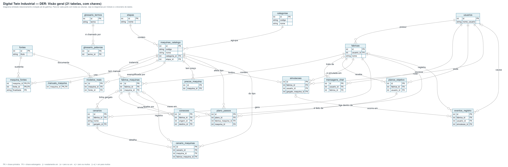
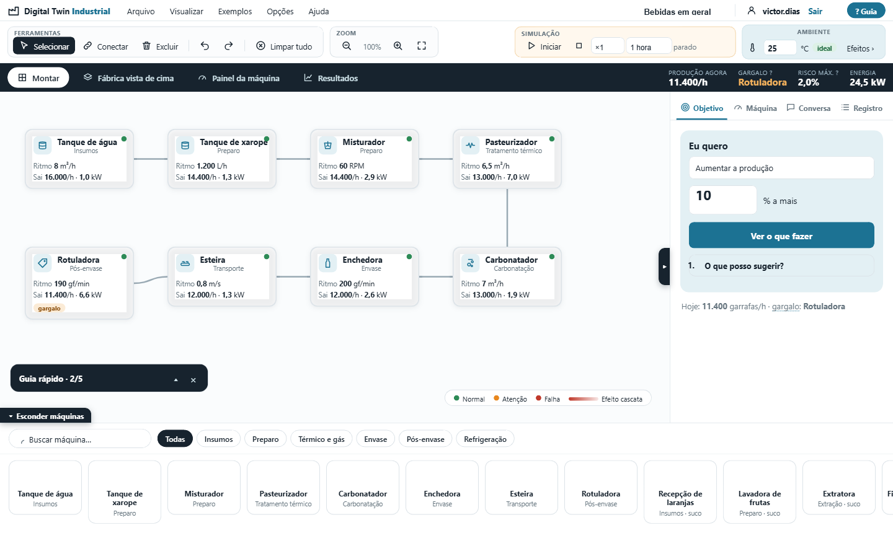
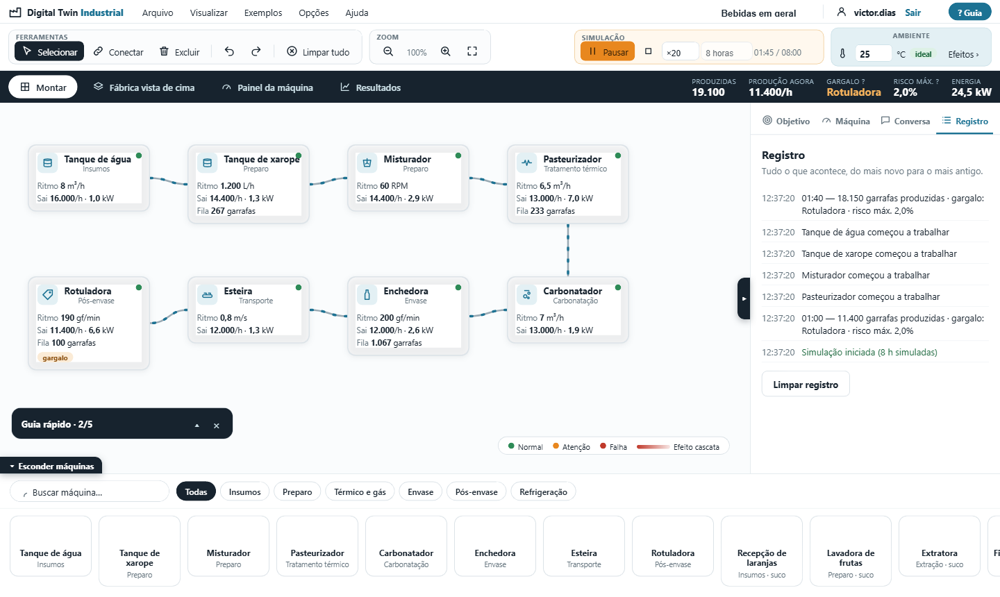
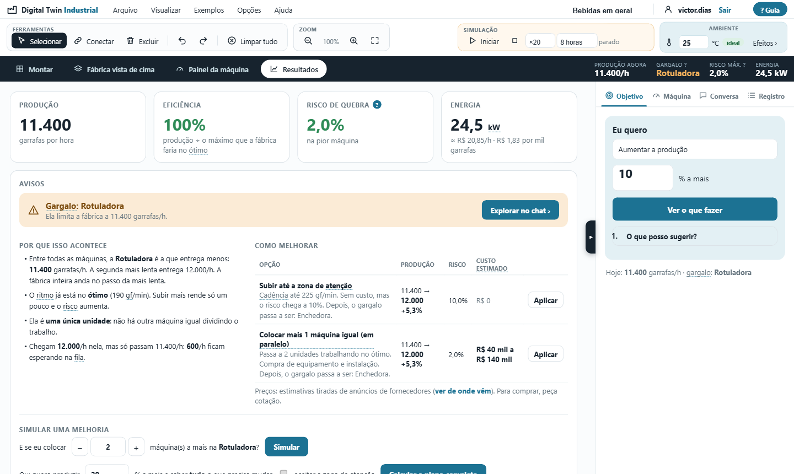

# Digital Twin Industrial: front-end e base de dados

Simulador de fábrica de bebidas no estilo **Cisco Packet Tracer**: você monta o mapa da fábrica arrastando máquinas, liga uma na outra, ajusta o ritmo de cada uma e vê, em números e em palavras simples, a produção, o **gargalo**, o risco de falha, o consumo de energia e como melhorar o desempenho (e quanto custaria).

Este repositório tem o **front-end** (React + TypeScript, Sprint 0) e a **base de dados** (21 tabelas, DER e CRUD, Sprint 1). A simulação do front roda no próprio navegador, então não precisa de servidor.

---

## Professor, para ver o sistema funcionando

1. Baixe o repositório: botão verde **Code › Download ZIP**, e **descompacte** o arquivo.
2. Abra a pasta **`ABRIR_AQUI`**.
3. Dê **duplo clique em `index.html`**. O sistema abre no navegador (Chrome, Edge ou Firefox).
4. Na tela de login, entre com qualquer usuário e senha (nenhuma senha é verificada).

Não precisa instalar nada (sem Node, sem Docker, sem servidor).

> Se preferir, o mesmo sistema está publicado online em **https://victorrafaeldias.github.io/digital-twin-industrial/** (basta clicar).
> Atenção: não abra o `app/index.html`. Ele é só o ponto de partida do código-fonte.

Dica para começar: no menu **Exemplos**, carregue "Bebidas em geral", clique em **Iniciar** (caixa Simulação) e depois abra a aba **Resultados**. O menu **Ajuda › Guia da plataforma** explica cada tela, com imagens.

## Professor, para ver a base de dados (Sprint 1)

Tudo está na pasta **[`banco-de-dados/`](banco-de-dados/)**. O [README dela](banco-de-dados/README.md) tem o passo a passo; em resumo:

| O que | Onde |
|---|---|
| **DER** (diagrama entidade-relacionamento) | [`banco-de-dados/der/`](banco-de-dados/der/): comece por `DER-visao-geral.png` |
| **Banco pronto, com as 21 tabelas criadas e populadas** | [`banco-de-dados/digital_twin.db`](banco-de-dados/digital_twin.db) (abre no [DB Browser for SQLite](https://sqlitebrowser.org/)) e scripts em [`banco-de-dados/sql/`](banco-de-dados/sql/) |
| **CRUD** (Create, Read, Update, Delete) | `python banco-de-dados/scripts/crud_demo.py` mostra os comandos e os resultados em todas as tabelas |
| Dicionário de dados e decisões de modelagem | [`banco-de-dados/docs/`](banco-de-dados/docs/) |



## Sumário

- [Sobre o projeto](#sobre-o-projeto)
- [Funcionalidades](#funcionalidades)
- [Base de dados](#professor-para-ver-a-base-de-dados-sprint-1)
- [Telas](#telas)
- [Rodar o código (desenvolvimento)](#rodar-o-código-desenvolvimento)
- [Scripts](#scripts)
- [Estrutura do repositório](#estrutura-do-repositório)
- [Tecnologias](#tecnologias)
- [Arquitetura e decisões](#arquitetura-e-decisões)
- [Testes](#testes)
- [Limitações e próximos passos](#limitações-e-próximos-passos)
- [Equipe e contexto](#equipe-e-contexto)

## Sobre o projeto

O objetivo é **mostrar como melhorar a performance de uma fábrica**: mudar um parâmetro (por exemplo, o ritmo de uma máquina ou a temperatura do ambiente) e ver o impacto (por exemplo, +8% de produção e mais risco de falha), com uma explicação em linguagem simples do que acontece e por quê. O sistema também mostra o equilíbrio entre ganho e desgaste.

O setor inicial é o de **bebidas**, com dois fluxos prontos:

- **Bebidas em geral:** tanques, misturador, pasteurizador, carbonatador, enchedora, esteira e rotuladora.
- **Suco de laranja natural:** recepção, lavadora, extratora, filtro, envasadora e câmara fria (sem pasteurização).

O catálogo de 14 máquinas é **dado** (não código fixo), para permitir outros setores depois. Todo número real tem **link da fonte**; o que é hipótese traz uma nota dizendo em que se baseia.

## Funcionalidades

- **Montar a fábrica:** arrastar máquinas, mover, conectar e excluir; desfazer e refazer; salvar e abrir a fábrica em arquivo `.json`.
- **Regras de conexão:** o sistema impede ligações sem sentido (ciclos, voltar etapas, misturar fluxos) e explica o motivo.
- **Efeito cascata:** uma máquina com problema pinta as conexões seguintes e mostra quem fica sem produto.
- **Simulação com tempo (Play):** velocidades ×1 a ×60, filas entre máquinas, energia e resultado final.
- **Gargalo explicado:** por que existe, como melhorar e **quanto custa** (preços estimados com fontes).
- **Simular uma melhoria:** "e se eu colocar mais 2 máquinas?", com recálculo em cascata quando outra máquina passa a limitar.
- **Objetivo:** "quero +10% de produção" gera um plano passo a passo, com o porquê de cada passo.
- **Temperatura ambiente:** efeito do calor e do frio nas máquinas e a dilatação da água.
- **Painel da máquina** (como o painel de um operador), **fábrica vista de cima**, **assistente de conversa** e **registro** de tudo o que acontece.
- **Ajuda completa:** guia da plataforma, manual das máquinas e glossário, com termos explicados nas próprias telas.
- **Configurações:** tipos de máquina, limites (ótimo, atenção, falha) e preços editáveis.

## Telas

| Montar a fábrica | Simulação em andamento |
|---|---|
|  |  |



O mapa completo de telas está em [docs/front-telas.md](docs/front-telas.md).

## Rodar o código (desenvolvimento)

Precisa do [Node.js](https://nodejs.org) 20 ou mais novo.

```bash
cd app
npm install
npm run dev
```

O sistema abre em `http://localhost:5175`.

## Scripts

Execute dentro da pasta `app/`:

| Comando | O que faz |
|---|---|
| `npm run dev` | servidor de desenvolvimento (porta 5175) |
| `npm run typecheck` | confere os tipos do TypeScript |
| `npm test` | roda os testes automatizados |
| `npm run build` | confere os tipos e gera a versão de produção em `app/dist/` |
| `npm run build:single` | gera um único `index.html` na pasta `ABRIR_AQUI/` (abre com duplo clique) |

## Estrutura do repositório

```
.
├── ABRIR_AQUI/        sistema pronto: index.html (duplo clique) + imagens do guia
├── app/               código-fonte (React + TypeScript + Vite)
│   └── src/
│       ├── engine/    motor de simulação (funções puras, sem React)
│       ├── store/     estado global (zustand) e ações do usuário
│       ├── data/      catálogo de máquinas, preços, fontes, glossário, textos
│       ├── components/, views/, modals/    interface
│       └── styles/
├── banco-de-dados/    base de dados: DER, banco SQLite pronto, scripts SQL, CRUD e testes (Sprint 1)
├── docs/              mapa de telas, decisões do código e preços estimados
└── index.html         redireciona para ABRIR_AQUI (usado na página publicada)
```

## Tecnologias

React 18 · TypeScript · Vite · zustand (estado) · Vitest (testes). Sem bibliotecas de interface de terceiros: o quadro de máquinas é feito em HTML e SVG.

## Arquitetura e decisões

- **O motor de simulação é separado da interface** (`app/src/engine`): são funções puras que recebem o desenho da fábrica e devolvem números. Dá para testar sem navegador e trocar depois por chamadas a uma API.
- **Estado em um só lugar** (`app/src/store/useStore.ts`): fábrica, seleção, desfazer/refazer, play, registro e configurações.
- **O catálogo é dado** (`app/src/data/catalog.ts`): limites, riscos, preços estimados e fontes de cada máquina.

Mais detalhes em [docs/front-codigo.md](docs/front-codigo.md) e em [app/README.md](app/README.md).

## Testes

```bash
cd app
npm test
```

São 18 testes: motor de simulação (gargalo, risco, falha em cascata, paralelo e fila, temperatura, play), regras de conexão, planejador de objetivo, relatório de gargalo, "e se..." com cascata e o estado da aplicação.

## Limitações e próximos passos

- A simulação é **didática**: os degraus de risco e os percentuais de temperatura são hipóteses (estão marcados assim no sistema). Os **preços são estimativas** de anúncios de fornecedores, não cotações ([docs/precos-maquinas.md](docs/precos-maquinas.md)).
- O assistente de conversa responde com base na fábrica atual; a leitura de manuais em PDF ainda é de demonstração.
- O front-end ainda não grava no banco: ele calcula tudo no navegador. O próximo passo é a API (FastAPI) que lê e grava nas tabelas de `banco-de-dados/`.
- Próximos passos: integrar com o backend (API FastAPI), salvar fábricas por usuário, leitura real de manuais (RAG) e dados reais de máquinas.

## Equipe e contexto

Trabalho da disciplina de PLN (FATEC Cotia), em dupla: **Victor Rafael de Oliveira Dias** e **Enzo Fernandes**. Professor: Braz Izaias da Silva Junior.

Projeto acadêmico. Nenhuma licença de uso foi definida até o momento.
